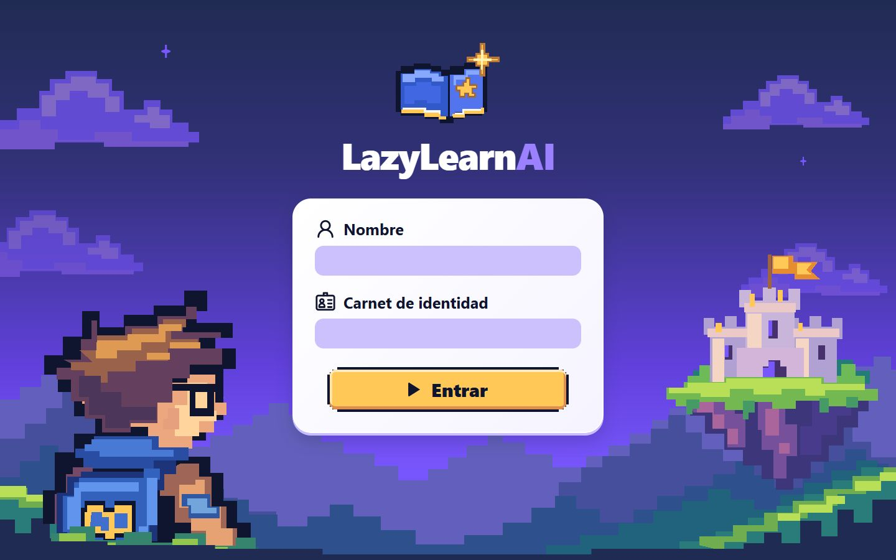
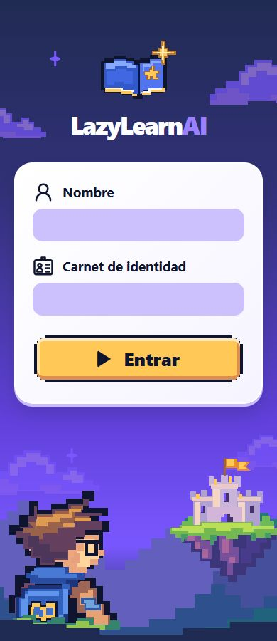

# Acceso de estudiante — implementación y entrega

Revisión local: 21 de noviembre de 2026. Rama: `feature/student-login-neoquest`.

**Nombre + carnet NO es autenticación segura. Solo usar datos ficticios en una
base de prueba. No verifica identidad oficial y permite suplantaciones.**

## Implementación

Una única aplicación FastAPI sirve la pantalla Jinja2 y sus recursos locales. El
formulario hace POST tradicional sin JavaScript, HTMX, CDN ni dependencias nuevas.
El GET del login no consulta la base de datos. La segunda fase añadió el dashboard protegido
descrito en `docs/codex/panel-estudiante/IMPLEMENTACION.md`.

El layout de acceso es independiente del starter. Reutiliza los tokens, primitivas
`ll-card` / `ll-button`, fuente `--ll-font-ui` e icono Lucide de usuario. Solo añade
tokens derivados locales para papel, lavanda de campos, cielo y sombra del botón.
`DESIGN_SYSTEM.md` aún describe la paleta anterior; se priorizó la especificación
NeoQuest aprobada para esta pantalla sin cambiar los tokens globales.

## Archivos

Nuevos:

- `backend/modules/student_access/{__init__,routes,service,repository}.py`.
- `frontend/templates/student_access_base.html`.
- `frontend/templates/pages/student_login.html` y `student_confirmed.html`.
- `frontend/static/css/student-login.css`.
- `frontend/static/art/login-{book,cloud,landscape,student,castle}.svg` y `README.md`.
- `frontend/static/icons/identity-card.svg`.
- `migrations/001_student_access.sql`.
- Este informe y `capturas/escritorio-1440.jpg`, `capturas/movil-390.jpg`.

Modificados:

- `backend/core/config.py`: secreto HMAC y excepción HTTP local explícita.
- `backend/main.py`: solo importación y registro del router.
- `backend/modules/demo/routes.py`: mover la demo anterior a `/demo`.
- `frontend/templates/base.html` y `pages/preview.html`: enlaces de regreso a `/demo`.
- `.env.example` y `migrations/README.md`: configuración e instrucciones.

La skill `student-login-neoquest` y los documentos 01–04/mockup ya estaban sin
seguimiento al empezar. Se conservaron. No se añadieron tests ni GitHub Actions.

## Rutas y flujo

| Ruta | Comportamiento |
| --- | --- |
| `GET /` | Formulario, 200 incluso sin Neon |
| `POST /student/access` | Valida, persiste y entrega cookie; 303 a `/student/dashboard` tras commit |
| `GET /student/access/confirmed` | Ruta compatible: valida la sesión y redirige al dashboard |
| `GET /demo` | Starter anterior |
| `GET /preview`, `/health`, `/health/db`, `/docs` | Contratos preservados |

`routes.py` recibe únicamente un formulario URL-encoded de hasta 4096 bytes, con
campos únicos `name` e `identity_number`. Usa el parser de la biblioteca estándar
porque el proyecto no incluye `python-multipart`. Los errores HTML nunca repiten
nombre, carnet, HMAC ni token. El usuario debe reintroducir los campos tras un error.
`novalidate` permite mostrar los mismos mensajes accesibles del servidor también
cuando se envían campos vacíos. No se depende de validación cliente.

`service.py` normaliza el nombre a Unicode NFC y espacios simples; admite de 2 a
80 caracteres y rechaza controles. El carnet se mantiene como texto: solo se
eliminan espacio ASCII y guion ASCII. Deben quedar 5–12 dígitos ASCII; conserva
ceros iniciales. Puntos, letras y dígitos Unicode no se aceptan. Esto no representa
las reglas de un carnet oficial.

El servicio calcula HMAC-SHA256 con `STUDENT_ID_HMAC_KEY`, genera el token con
`secrets.token_urlsafe(32)` y envía a `repository.py` únicamente el HMAC y el hash
SHA-256 del token. Psycopg ejecuta SQL parametrizado fuera del bucle async, con
timeout de conexión y consultas de 5 segundos. Perfil y sesión se guardan en la
misma transacción antes del 303.

El índice único y `ON CONFLICT DO NOTHING` evitan duplicar perfiles incluso con
envíos concurrentes. Un nombre diferente produce un rechazo genérico sin revelar
el nombre existente; para comparar se ignora capitalización mediante `casefold`.
Un acceso repetido válido reutiliza el perfil. Si trae una sesión anterior, la
revoca dentro de la misma transacción y entrega un token nuevo.

La cookie dura 8 horas, tiene `HttpOnly`, `SameSite=Lax`, `Path=/` y `Secure` por
defecto. La BD comprueba `expires_at > now()` al resolver la sesión. El dashboard recibe
únicamente UUID y nombre del perfil; nunca el carnet o su HMAC. Las respuestas usan
`Cache-Control: no-store`.
Los envíos con origen externo se rechazan; `Origin: null` solo se acepta si el
encabezado del navegador `Sec-Fetch-Site` indica `same-origin`.

## Esquema SQL

| Tabla | Campos |
| --- | --- |
| `student_demo_profiles` | `id UUID PK`, `display_name VARCHAR(80)`, `identity_hmac CHAR(64) UNIQUE`, `created_at TIMESTAMPTZ` |
| `student_demo_sessions` | `id UUID PK`, `profile_id UUID FK`, `token_hash CHAR(64) UNIQUE`, `created_at TIMESTAMPTZ`, `expires_at TIMESTAMPTZ` |

Todos los campos son obligatorios. Los UUID se generan en Python. Hay un índice
de vencimiento de sesiones. La migración usa `CREATE ... IF NOT EXISTS` y una
transacción; no usa DROP, extensiones ni migraciones automáticas.

## Configuración y migración manual

1. Crear o elegir una rama **de prueba** de PostgreSQL/Neon.
2. Copiar `.env.example` a `.env` (ignorado por Git), configurar `DATABASE_URL`
   pooled y `DATABASE_URL_DIRECT` directa con TLS según Neon.
3. Generar una clave aleatoria de al menos 32 bytes. Para una sesión de PowerShell,
   este comando captura la salida sin imprimir el secreto en consola:

   ```powershell
   $env:STUDENT_ID_HMAC_KEY = uv run python -c "import secrets; print(secrets.token_urlsafe(32))"
   ```

   Conservar una clave estable en el gestor de secretos o `.env` privado para
   futuros arranques. La configuración rechaza claves menores de 32 bytes, pero
   la longitud no garantiza entropía: no usar frases o valores inventados.
4. Aplicar **una vez manualmente**, desde la raíz, después de revisar el SQL:

   ```powershell
   @'
   import os
   from pathlib import Path
   import psycopg

   with psycopg.connect(os.environ["DATABASE_URL_DIRECT"], connect_timeout=5) as connection:
       connection.execute(Path("migrations/001_student_access.sql").read_text(encoding="utf-8"))
   print("Migración aplicada")
   '@ | uv run --env-file .env python -
   ```

   Alternativamente, pegar el SQL en el editor de la rama de prueba de Neon.
   No se ejecutó esta migración durante esta entrega por falta de credenciales.
5. Para HTTP local, poner `STUDENT_ALLOW_LOCAL_HTTP=1` en `.env`. Solo surte efecto
   con hostname loopback y HTTP; se ignora si existe `VERCEL`. En producción dejar
   `0`, configurar las variables del servidor y utilizar HTTPS.
6. Arrancar:

   ```powershell
   uv sync --dev
   uv run --env-file .env uvicorn backend.main:app --reload
   ```

   El código usa variables de proceso; no carga `.env` automáticamente. La opción
   `--env-file` de uv lo carga sin añadir una dependencia. Para revisar solo el
   diseño se ejecutó `uv run uvicorn backend.main:app --reload` sin `.env`.

No rotar la clave HMAC sin planificar los perfiles existentes: los nuevos HMAC no
coincidirán con los anteriores. No publicar variables, capturas de cookies ni
salidas de consultas con identificadores o hashes.

## Verificación realizada

| Comprobación | Resultado observado |
| --- | --- |
| `uv sync --dev` | Correcto: 21 paquetes resueltos, 20 comprobados |
| `uv run ruff check .` | Correcto tras corregir dos `with` anidados |
| `uv run ruff format --check .` | Correcto: 43 archivos formateados en la comprobación final |
| Uvicorn con `--reload` | Arrancó en `127.0.0.1:8000` |
| `/`, `/demo`, `/preview`, `/health`, `/docs` | HTTP 200 |
| `/health/db` sin configuración | HTTP 503 controlado, esperado |
| Confirmación sin cookie | HTTP 303 a `/`, elimina cookie |
| Nombre/carnet vacíos por Enter en navegador | Errores accesibles; foco en primer campo inválido |
| POST inválido por HTTP | 422, mensajes asociados a ambos campos |
| POST ficticio válido sin configuración | 503, sin afirmar persistencia ni repetir carnet |
| Nombre corto/largo; carnet corto/largo, puntos y dígitos no ASCII | Rechazados en revisión de servicio por consola |
| Espacios y guiones permitidos | Normalizados; ceros iniciales conservados |
| Conexión a puerto local cerrado | Error de servicio controlado, sin error interno del driver |
| Envío cross-site | HTTP 403 |
| Cuerpo mayor de 4096 bytes | HTTP 413 |
| Campos duplicados / JSON | HTTP 400 / 415 |
| Token ausente/malformado | No permite confirmación |
| SVG y CSS | Cargan; todas las imágenes tienen dimensiones naturales válidas |
| 320 / 390 / 768 / 1440 px | Revisión visual en navegador y medidas DOM, sin overflow horizontal |
| Tab y foco | Contorno de 3 px en campo y botón; orden Nombre → Carnet → Entrar |
| Área táctil | Inputs 46–48 px; botón 58–64 px |
| Contraste calculado | Texto/campo 10,78:1; texto/botón 11,66:1; error/tarjeta 6,79:1 |
| Altura reducida a 400 px | Tab desplaza el botón dentro del viewport |
| Dependencia de JS | Cero scripts en el acceso; POST HTML tradicional |

Las revisiones fueron solicitudes HTTP, inspección de código, llamadas manuales
por consola y navegación real; no se añadieron suites ni infraestructura de tests.
Se corrigió durante la revisión un rechazo del navegador integrado causado por
`Origin: null`, manteniendo el bloqueo cross-site.

**Pendiente por falta de credenciales:** aplicar SQL en Neon, alta persistida,
repetición y no duplicación real, rechazo de otro nombre contra un perfil guardado,
cookie tras commit, confirmación con sesión válida/expirada y rotación de sesión.
El flujo SQL y flags de cookie están implementados y revisados en código; no se
presentan como verificados contra una base real. No hay `.env` ni credenciales de
BD/HMAC disponibles. No se simuló persistencia en memoria.

**Pendiente en dispositivo físico:** teclado virtual móvil y lector de pantalla.
La altura reducida fue una simulación de viewport, no un teclado móvil real.
`prefers-reduced-motion` está contemplado en CSS; no hay animaciones del escenario.

## Capturas y comparación





Se conservan marca superior, libro con destello, tarjeta clara, dos campos lavanda,
botón dorado, estudiante a la izquierda, castillo flotante a la derecha, nubes y
montañas. En móvil las ilustraciones quedan debajo de los controles.

La referencia es más detallada, con sombreado orgánico y trazos menos cuadrados.
Estos SVG originales son más simples, con píxeles grandes; no son una copia exacta.
Para igualarla hace falta el arte limpio en capas (personaje, castillo, paisaje,
libro y nubes). No se usan el marco de dispositivo ni la barra de estado del mockup.
La tipografía sigue siendo system-ui según la instrucción del equipo.

## Riesgos y siguiente revisión

- Identificar por nombre/documento permite suplantación. No usar con estudiantes
  reales ni convertir la confirmación en autorización para información educativa.
- No hay límites de intentos persistentes ni controles contra abuso automatizado;
  el rechazo genérico no elimina todos los posibles indicios de existencia.
- El HMAC reduce exposición del identificador; no vuelve anónimos los datos. El
  nombre se guarda en claro y debe ser ficticio. Proteger clave, BD y backups.
- Las sesiones vencidas se rechazan pero no se borran automáticamente. Definir
  una retención y limpieza manual de los datos de demo antes de publicar.
- Validar HTTPS, cookies y encabezados del proxy en el despliegue real de Vercel.

## Git y PR

Los cambios quedan locales y sin commit para revisión. No se hizo push, merge ni
modificación de `main`. Antes de preparar el PR:

1. Revisar `git status -sb`, el diff y los archivos nuevos.
2. Añadir explícitamente los archivos de implementación listados arriba; revisar
   por separado la skill y especificaciones que ya estaban sin seguimiento.
3. Ejecutar Ruff y completar la revisión de Neon con datos ficticios.
4. Hacer commit en `feature/student-login-neoquest`.
5. Cuando se decida publicar la rama: `git push -u origin feature/student-login-neoquest`.
6. Abrir PR con base `main`, adjuntar estas capturas y señalar las verificaciones
   de BD que sigan pendientes. Título sugerido: `Acceso demo de estudiantes con NeoQuest`.

No integrar hasta revisar la diferencia artística y comprobar la persistencia.
