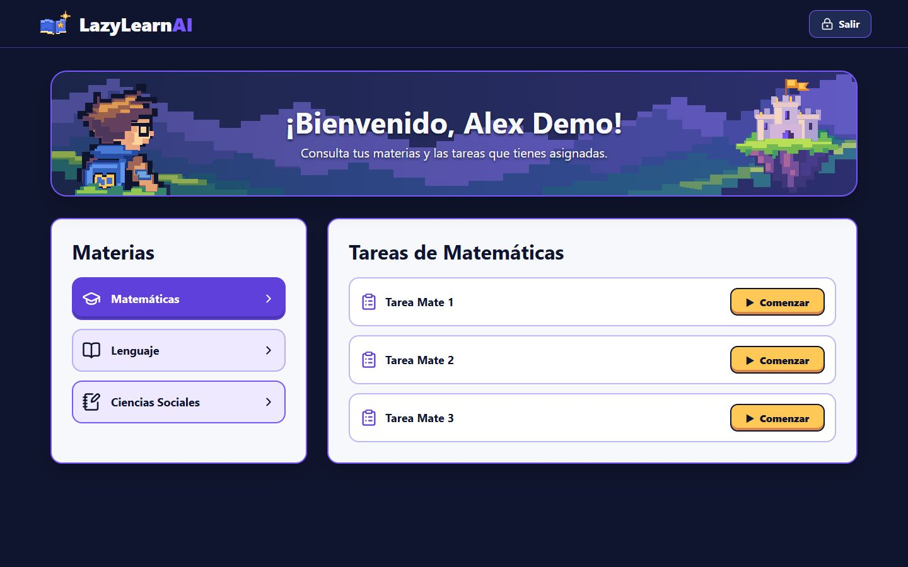
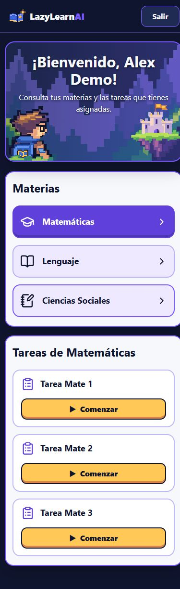

# Panel principal del estudiante

Implementado el 21 de noviembre de 2026 en `feature/student-login-neoquest`, sin commit,
push ni merge. Conserva todos los cambios locales del acceso de estudiante.

## Resultado

El login ahora redirige a `GET /student/dashboard` después de persistir la sesión. El panel
vuelve a calcular el hash de la cookie, consulta la sesión no vencida y obtiene desde
PostgreSQL el UUID y el nombre del perfil. El carnet, su HMAC y el token nunca se envían al
HTML. Una cookie existente sin sesión válida recibe un 303 al login.

El dashboard contiene solamente encabezado, Salir, banner de bienvenida, Materias y Tareas.
La selección usa enlaces GET y funciona sin JavaScript. Los botones Comenzar son formularios
POST; antes de redirigir verifican que la tarea esté publicada y asignada al perfil. La ruta
de transición solo informa que la resolución aún no está disponible.

El logout usa POST, valida el origen/Sec-Fetch-Site, elimina el hash de sesión en la base,
borra la cookie y redirige a `/`. Si la revocación falla, devuelve 503 y conserva la cookie,
evitando aparentar que la sesión fue invalidada.

## Archivos de esta fase

Nuevos:

- `backend/modules/student_dashboard/{__init__,routes,service,repository}.py`.
- `backend/modules/student_access/http.py`, con política de cookie y origen compartida.
- `frontend/templates/student_dashboard_base.html`.
- `frontend/templates/pages/student_dashboard.html`.
- `frontend/templates/pages/student_task_unavailable.html`.
- `frontend/templates/components/student_dashboard.html`.
- `frontend/static/css/student-dashboard.css`.
- `migrations/002_student_dashboard.sql`.
- `migrations/demo_student_dashboard.sql`, opcional y solo para cuentas ficticias.
- Capturas `capturas/dashboard-1440.jpg` y `capturas/dashboard-390.jpg`.

Modificados:

- `backend/main.py`, para registrar el router.
- `backend/modules/student_access/{routes,service,repository}.py`, para redirección,
  contexto de sesión y revocación.
- `migrations/README.md` y el informe de la primera pantalla.

No se agregaron paquetes, JavaScript, tests, GitHub Actions, arte nuevo, chat ni Gemini.

## Modelo de datos

`002_student_dashboard.sql` es manual, transaccional y no destructiva:

| Tabla | Finalidad |
| --- | --- |
| `student_demo_subjects` | Catálogo de materias activas, slug, nombre e icono permitido |
| `student_demo_subject_enrollments` | Materias visibles para cada perfil ficticio |
| `student_demo_tasks` | Título, materia, publicación y marca `is_demo` |
| `student_demo_task_assignments` | Asignación individual de tarea a perfil |

El repositorio primero limita las materias por inscripción. Las tareas requieren a la vez
perfil asignado, materia seleccionada y `is_published = TRUE`. Los UUID del esquema se
aportan desde la capa que cree datos. El script demo usa UUID explícitos/determinísticos y
no requiere extensiones PostgreSQL.

El modelo actual es por cuenta. Cuando exista gestión docente/grupos, esa fase deberá crear
las tareas con `is_demo = FALSE`, publicar explícitamente y registrar asignaciones. Si se
requieren grupos, debe añadirse un modelo de grupo/membresía y ampliar la consulta; no se
asumió una estructura docente inexistente.

## Migración manual

Aplicar después de `001_student_access.sql` en una rama de prueba de Neon:

```powershell
psql $env:DATABASE_URL_DIRECT -v ON_ERROR_STOP=1 -f migrations/002_student_dashboard.sql
```

Para cargar el ejemplo visual en un perfil estrictamente ficticio, obtener su UUID desde la
base de prueba y revisar antes el script:

```powershell
psql $env:DATABASE_URL_DIRECT -v ON_ERROR_STOP=1 `
  -v profile_id='UUID-DEL-PERFIL-FICTICIO' `
  -f migrations/demo_student_dashboard.sql
```

El script demo crea Matemáticas, Lenguaje y Ciencias Sociales, las inscribe en el perfil e
incluye seis tareas marcadas como demo. No se ejecuta durante arranque o build. Nunca usar
un perfil real ni presentar esos registros como asignaciones docentes.

## Verificación real

Se creó un clúster PostgreSQL 17 temporal aislado en `127.0.0.1:55432`, se aplicaron 001 y
002 manualmente y se cargaron los datos demo para `Alex Demo`. No se usó ni se probó Neon.
Al terminar, se detuvieron FastAPI y PostgreSQL y se eliminó el directorio temporal.

- Login: 303 a `/student/dashboard`; cookie local HttpOnly, SameSite Lax, Path `/`.
- Dashboard: 200, bienvenida con nombre de la sesión y tareas de Matemáticas.
- Lenguaje: selección 200 y dos tareas diferentes obtenidas de PostgreSQL.
- Ciencias Sociales sin publicación: estado vacío correcto.
- Comenzar: 303 para tarea publicada/asignada; 404 para UUID no asignado y tarea no publicada.
- Logout: 303 a `/`; la cookie anterior recibe 303 al login y el hash desaparece de BD.
- Cookie local: `HttpOnly`, `Max-Age=28800`, `Path=/`, `SameSite=Lax`; una sesión forzada a
  expirar en PostgreSQL recibió 303 al login. `Secure` queda activo por defecto fuera de la
  excepción loopback explícita del entorno local.
- Repetición de carnet ficticio: un solo perfil; nombre diferente devuelve mensaje genérico
  sin revelar `Alex Demo`.
- Cross-site logout: 403. Dashboard sin cookie: 303 al login.
- Las imágenes estáticas cargaron y el dashboard no contiene scripts.
- 320, 390, 768 y 1440 px: sin overflow horizontal. A 390 los paneles se apilan; a 768 y
  1440 usan dos columnas. Controles interactivos miden al menos 44 px.
- Foco de teclado visible mediante contorno cian de 3 px.
- `uv run ruff check .`: correcto.
- La migración 002 y el script demo se aplicaron dos veces: conservaron 3 materias, 3
  inscripciones, 6 tareas y 6 asignaciones sin duplicados.
- `uv run ruff format --check .`: 49 archivos formateados en la comprobación final.

## Capturas





## Comparación y limitaciones

La referencia requerida `frontend/static/images/student-dashboard-reference.png` no existe
en el repositorio ni llegó junto al texto adjunto. La búsqueda encontró únicamente el mockup
del login y capturas previas. Por eso no es posible afirmar fidelidad píxel a píxel ni hacer
recortes de esa imagen.

La implementación sigue la composición escrita: logo/Salir, banner con estudiante y castillo,
Materias a la izquierda y Tareas más anchas a la derecha; en móvil se apilan. Reutiliza sin
modificar `login-student.svg`, `login-castle.svg`, `login-landscape.svg`, `login-book.svg` y
los iconos locales existentes. No se generó ni dibujó arte nuevo para esta fase.

Quedan pendientes la comparación visual contra el PNG ausente, el modelo de grupos, la
interfaz docente, la pantalla de resolución, la descripción del ejercicio, progreso y chat.
También debe probarse la migración en una rama Neon de ensayo antes del PR.

## Arranque y PR

```powershell
uv sync --dev
uv run --env-file .env uvicorn backend.main:app --reload
uv run ruff check .
uv run ruff format --check .
```

Revisar `git status -sb`, el diff y todos los archivos sin seguimiento. Después de probar en
Neon, hacer un commit en la rama actual y abrir un PR pequeño hacia `main`. Título sugerido:
`Panel de materias y tareas del estudiante`. No integrar hasta adjuntar el PNG aprobado y
comparar la implementación con él.
